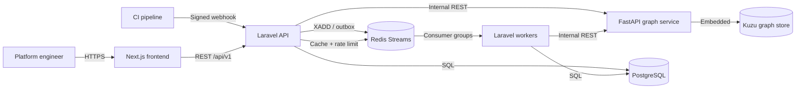
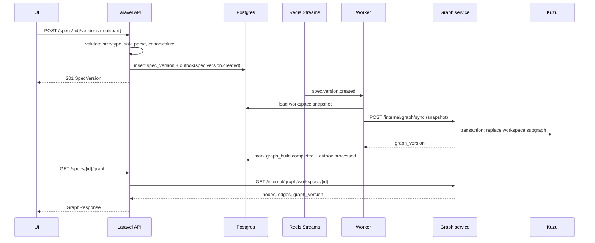
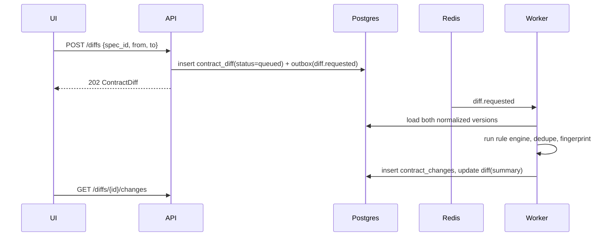
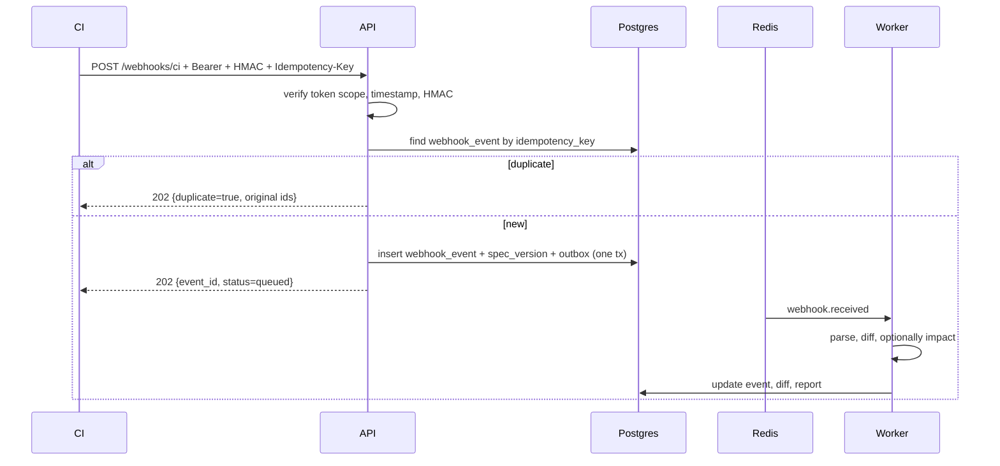

# Architecture

## 1. Context

BlastSpec is a single-workspace web application that ingests OpenAPI documents, builds a service-dependency graph, detects contract changes, and produces migration-ready impact reports.



There is **no standalone KuzuDB server**. Kuzu is embedded in the graph service and owns a directory on a persistent volume (ADR-0002).

## 2. Containers and responsibilities

| Container | Runtime | Owns | Must never do |
|---|---|---|---|
| **Frontend** | Next.js (App Router, TypeScript) | UI, routing, client state, generated API types | Talk to Postgres, Redis, or Kuzu directly |
| **Laravel API** | PHP 8.3+, Laravel | Auth, workspace, services, specs, canonicalization, diff engine, report orchestration, webhooks, tokens, outbox writes | Write to Kuzu directly |
| **Graph service** | Python 3.12, FastAPI | Kuzu schema and writes, graph queries, reverse reachability, topological order, SCC detection | Read Postgres; accept public traffic |
| **Workers** | Laravel queue commands | Outbox relay, stream consumption, diff jobs, graph sync jobs, impact jobs, DLQ handling | Serve HTTP |
| **PostgreSQL** | Postgres 16 | System of record for every domain entity and every job outcome | Store derived graph data as the source of truth |
| **Redis** | Redis 7 | Streams, consumer groups, cache, rate limits | Be the only record of a job |
| **Kuzu** | Embedded library | Derived graph for fast traversal | Be the only copy of any domain data |

## 3. Data ownership and consistency

**Postgres is the system of record.** Every entity needed to rebuild the graph is stored there:

- services and owner teams
- spec versions with raw content and normalized JSON
- consumer bindings (declared, inferred, manual)
- diffs, changes, reports, approvals
- webhook events, outbox rows, DLQ rows

**Kuzu is derived.** A full graph sync can reconstruct it from Postgres at any time. Consequences:

- Losing the Kuzu volume is an availability incident, not a data-loss incident.
- Every graph response carries `graph_version`, the SHA-256 of the canonical input snapshot.
- If the graph's version does not match the latest snapshot hash, the response is marked `stale: true`.
- Impact analysis refuses to run on a stale graph (`503 ERR-1402`) and offers a rebuild.

### Write path

1. API commits the domain change and an `outbox` row in **one Postgres transaction**.
2. `outbox:relay` claims pending rows with `FOR UPDATE SKIP LOCKED` and `XADD`s them to a Redis stream.
3. A worker consumes with a consumer group, performs the job, and `XACK`s only after success.
4. The resource's status column is the user-visible truth. Redis is transport, not storage.

## 4. Synchronous vs asynchronous

| Operation | Mode | Why |
|---|---|---|
| Auth, services, spec list/detail, tokens | Sync | Small, indexed reads |
| Spec upload + parse | Sync | 5 MB cap; user needs immediate validation feedback |
| Graph read | Sync | Fast Kuzu traversal |
| Graph sync/rebuild | Async | Can touch the whole workspace |
| Diff | Async | CPU-bound over large documents |
| Impact analysis | Async | Multi-step graph traversal + persistence |
| CI webhook | Sync accept, async processing | Return `202` quickly; retries are safe |
| Report approval | Sync | Single row update |

Async resources expose `status` and `error`; clients poll the resource endpoint. There is no separate jobs API in v1.

## 5. Key flows

### 5.1 Upload and graph sync



### 5.2 Diff



The diff engine is implemented in Laravel (`app/Services/Diff`). It operates on the normalized JSON shape, not raw YAML.

### 5.3 Impact report

```mermaid
sequenceDiagram
    participant UI
    participant API
    participant PG as Postgres
    participant R as Redis
    participant W as Worker
    participant GS as Graph service

    UI->>API: POST /impact-reports {diff_id, change_ids}
    API->>PG: insert impact_report(status=queued) + outbox(impact.requested)
    API-->>UI: 202
    R->>W: impact.requested
    W->>PG: load changes + endpoints + bindings
    W->>GS: POST /internal/graph/impact {endpoint_ids, workspace_id}
    GS-->>W: affected services, depth, evidence, graph_version
    W->>GS: POST /internal/graph/migration-order {service_ids}
    GS-->>W: waves, cycles, order
    W->>PG: persist items, waves, cycles; status=completed
    UI->>API: GET /impact-reports/{id}
```

### 5.4 CI webhook



## 6. Graph service contract

The graph service is internal-only. Laravel authenticates with `X-Internal-Token`; the port is not exposed publicly in production.

| Endpoint | Purpose |
|---|---|
| `POST /internal/graph/sync` | Replace the workspace subgraph from a full snapshot. Returns `graph_version`. |
| `GET /internal/graph/workspace/{workspace_id}` | Return nodes/edges for the workspace or a spec version. |
| `POST /internal/graph/impact` | Reverse reachability from endpoint IDs. |
| `POST /internal/graph/migration-order` | Kahn order, waves, SCC cycles. |
| `GET /internal/health` | Readiness including Kuzu open status. |

Sync is idempotent: the same snapshot yields the same `graph_version` and the same graph contents.

## 7. Graph versioning

```text
snapshot = {
  workspace_id,
  services:        sorted by id,
  endpoints:       sorted by endpoint key,
  schema_components: sorted by key,
  consumer_bindings: sorted by (provider, method, path, consumer, source)
}
graph_version = sha256(canonical_json(snapshot))
```

- Computed by Laravel when building the snapshot and verified by the graph service.
- Stored on `graph_builds.graph_version` and returned in every graph/impact response.
- A diff records the spec version IDs it used; impact analysis requires a graph build containing those versions.
- Stale means: latest completed build's input set does not include the diff's target version, or a newer spec version exists.

## 8. Failure modes and recovery

| Failure | User sees | System behavior | Recovery |
|---|---|---|---|
| Graph service unavailable | Upload succeeds; graph shows `graph_pending`; impact returns `503 ERR-1401` | Outbox retries with backoff | Start service; relay drains |
| Kuzu write fails mid-sync | Previous graph remains | Transaction rollback; build marked `failed` | Retry build; full rebuild |
| Redis unavailable | Async resources stay `queued`; health degraded | Outbox accumulates in Postgres | Restore Redis; relay resumes |
| Worker crashes mid-job | Resource stuck `running` | Stream entry remains pending; `XAUTOCLAIM` after 60 s | Automatic reclaim |
| Duplicate webhook | `202 duplicate=true` with original IDs | Unique `idempotency_key` | None needed |
| Duplicate outbox publish | Job reprocessed | Job handlers are idempotent by aggregate + version | None needed |
| Stale graph | Report creation returns `ERR-1402` | Rebuild queued automatically | Poll or rebuild manually |
| Postgres/Kuzu divergence | `stale=true` | Graph never trusted for writes | Full rebuild |
| Spec parse timeout | `422 ERR-1201` | No version persisted | Fix document |

### Retry policy

- Max attempts: **3** for diff, graph sync, impact, webhook processing.
- Backoff: 2 s, 10 s, 30 s (+ jitter).
- Pending stream entries reclaimed after **60 s** idle via `XAUTOCLAIM`.
- After the third failure: write `dlq_jobs` row, mark the resource `failed`, emit `ERR-1304`/`ERR-1403`.
- DLQ replay creates a new attempt with `retry_count + 1`, preserves the original payload, and is idempotent.

## 9. Security boundaries

- Public: frontend, `/api/v1/*`.
- Internal: graph service (`/internal/*`) reachable only on the private network.
- Data: Postgres and Redis are not publicly exposed.
- Secrets: `APP_KEY`, `GRAPH_SERVICE_TOKEN`, `WEBHOOK_SECRET`, DB/Redis credentials.
- Upload parsing is sandboxed: no remote `$ref`, size/depth limits, safe YAML loader.

See `SECURITY.md` for the threat model.

## 10. Scale assumptions

MVP targets, per workspace:

| Dimension | Target |
|---|---|
| Services | 50 |
| Spec versions | 500 |
| Endpoints | 5,000 |
| Consumer bindings | 50,000 |
| Graph nodes | 100,000 |
| Concurrent users | 10 |

These bounds justify full-snapshot sync and in-process algorithms. Beyond them, move to incremental graph updates and paginated graph reads (out of scope).

## 11. Deployment topology

```text
Vercel:        frontend
Fly.io app 1:  laravel-api  (public)
Fly.io app 2:  graph-service (private) + Kuzu volume
Fly.io app 3:  laravel-worker (private)
Managed:       Postgres, Redis
```

Local compose has the same logical containers, with Postgres and Redis as local services and Kuzu as a volume inside the graph service. See `DEPLOYMENT.md`.

## 12. Related decisions

- ADR-0001 contract-first API
- ADR-0002 Kuzu embedded, derived store
- ADR-0003 Postgres system of record + outbox
- ADR-0004 Redis Streams consumer groups
- ADR-0005 consumer discovery precedence
- ADR-0006 change fingerprints
- ADR-0007 graph visualization stack
- ADR-0008 demo auth and CI tokens
