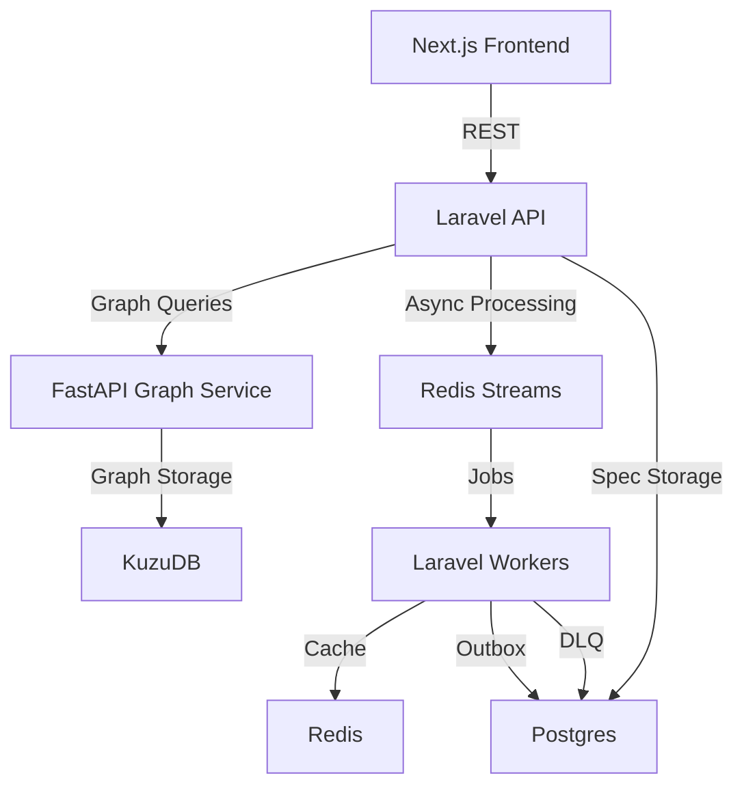

# Project 4: API Contract Change Impact Analyzer

## Overview

### Elevator Pitch
Upload OpenAPI specs or connect repos. Build a service-dependency graph. When a contract changes, generate impact report: which services break, which teams to notify, suggested migration order.

### Recruiter Hook
"Built API impact analyzer modeling service dependencies as graph; produces migration-ready impact reports from contract changes—platform engineering signal."

### Why Unique
API drift is a real enterprise pain; few portfolio projects address it with graph reachability + migration ordering.

### Goals
- Detect breaking changes in OpenAPI specs
- Model service dependencies as graph
- Generate impact reports with affected consumers
- Suggest migration order (topological sort)

### Non-Goals
- Full OpenAPI spec validation (use existing tools like Spectral)
- Schema evolution (e.g., backward-compatible changes)

## User Stories & Core Flows

### Upload OpenAPI Specs
1. User uploads 3 OpenAPI specs (JSON/YAML)
2. System parses specs, normalizes endpoints, and builds dependency graph
3. User sees graph visualization (services, endpoints, consumers)

### Detect Contract Changes
1. User selects an endpoint to modify
2. System compares new spec with previous version
3. System flags breaking changes (removed fields, type changes, new required fields, status-code changes...)

### Generate Impact Report
1. System traverses graph to find consumers affected by changes
2. System generates report with:
   - Affected services
   - Teams to notify
   - Migration order (topological sort)
3. User reviews report and approves migration plan

## Architecture



### Service Boundaries
- **Laravel API**: Spec parsing, validation, webhook handling, outbox pattern
- **FastAPI Graph Service**: Graph algorithms (reachability, topological sort)
- **Workers**: Async processing (diffing, impact analysis)

## Graph Schema

### Nodes
- `Service` (name, description, owner)
- `APIEndpoint` (path, method, tags, summary)
- `Consumer` (service, endpoint, consumer_service)
- `SchemaComponent` (type, format, required, enum)

### Edges
- `PROVIDES` (Service → APIEndpoint)
- `CONSUMES` (Consumer → APIEndpoint)
- `DEPENDS_ON` (Service → Service)
- `REFERENCES` (APIEndpoint → SchemaComponent)

### Example Queries

#### Reverse Reachability (Impact Analysis)
```cypher
MATCH (e:APIEndpoint {path: '/users', method: 'GET'})<-[:CONSUMES]-(c:Consumer)
RETURN c.service AS affected_service
```

#### Topological Migration Order
```cypher
MATCH (s:Service)
WITH s, [(s)-[:DEPENDS_ON]->(other:Service) | other] AS dependencies
RETURN s.name AS service, dependencies
ORDER BY size(dependencies) DESC
```

## Postgres Data Model

### Tables
- `specs` (id, name, description, created_at, updated_at)
- `spec_versions` (id, spec_id, version, content, created_at)
- `contract_diffs` (id, spec_id, from_version, to_version, changes, created_at)
- `impact_reports` (id, diff_id, affected_services, migration_order, created_at)
- `webhook_events` (id, event_type, payload, status, created_at, processed_at)
- `outbox` (id, event_type, payload, status, created_at, processed_at)
- `dlq_jobs` (id, job_type, payload, error, retry_count, created_at, last_attempt_at)

## Breaking-Change Taxonomy

### Severity Levels
- **Critical**: Breaks existing consumers
- **Warning**: May cause issues but not break
- **Info**: Non-breaking change

### Rules
- Removed operation/field
- New required field
- Type change (e.g., string → integer)
- Status-code change (e.g., 200 → 201)
- Enum narrowing (e.g., ['A', 'B'] → ['A'])

## Algorithms

### Reverse Reachability
```python
def find_affected_consumers(endpoint_id):
    query = """
    MATCH (e:APIEndpoint {id: $endpoint_id})<-[:CONSUMES]-(c:Consumer)
    RETURN c.service AS affected_service
    """
    return kuzu.query(query, {'endpoint_id': endpoint_id})
```

### Topological Migration Order
```python
def topological_sort(services):
    in_degree = {s: 0 for s in services}
    graph = {s: [] for s in services}

    for s in services:
        for dep in s.dependencies:
            graph[dep].append(s)
            in_degree[s] += 1

    queue = [s for s in services if in_degree[s] == 0]
    topo_order = []

    while queue:
        s = queue.pop(0)
        topo_order.append(s)
        for neighbor in graph[s]:
            in_degree[neighbor] -= 1
            if in_degree[neighbor] == 0:
                queue.append(neighbor)

    return topo_order
```

## REST API Design

### Endpoints

| Endpoint | Method | Description | Payload | Response |
|---|---|---|---|---|
| `/api/specs` | POST | Upload OpenAPI spec | `{spec: File}` | `{spec_id: string}` |
| `/api/specs/{spec_id}/graph` | GET | Get service graph | - | `{nodes: Node[], edges: Edge[]}` |
| `/api/specs/{spec_id}/diff` | POST | Diff specs | `{from_version: string, to_version: string}` | `{changes: Change[]}` |
| `/api/specs/{spec_id}/impact` | POST | Analyze impact | `{endpoint_id: string, changes: Change[]}` | `{affected_services: string[], migration_order: string[]}` |
| `/api/reports` | GET | List impact reports | - | `{reports: Report[]}` |
| `/api/webhooks` | POST | CI webhook | `{spec_id: string, version: string, hmac: string, idempotency_key: string}` | `{status: string}` |

## Repo Layout

```
project-4-api-impact-analyzer/
├── frontend/
│   ├── src/
│   │   ├── components/
│   │   ├── pages/
│   │   └── utils/
│   └── package.json
├── backend/
│   ├── app/
│   │   ├── Http/
│   │   ├── Jobs/
│   │   └── Models/
│   └── config/
├── graph-service/
│   ├── src/
│   │   ├── graph/
│   │   └── main.py
│   └── pyproject.toml
├── infra/
│   ├── docker-compose.yml
│   └── k8s/
└── docs/
    └── PROJECT_4_API_CONTRACT_IMPACT_ANALYZER.md
```

## Milestones

### Week 1
- [ ] Set up repo structure
- [ ] Implement spec upload endpoint
- [ ] Parse OpenAPI specs (Laravel)
- [ ] Build basic graph schema (KuzuDB)

### Week 2
- [ ] Implement graph visualization (Next.js)
- [ ] Add basic traversal queries (FastAPI)
- [ ] Set up Redis Streams for async processing

### Week 3
- [ ] Implement contract diffing logic
- [ ] Detect breaking changes
- [ ] Generate impact reports

### Week 4
- [ ] Add webhook handling (CI integration)
- [ ] Implement outbox pattern
- [ ] Set up DLQ for failed jobs

### Month 2
- [ ] Add topological migration ordering
- [ ] Improve UI with impact report details
- [ ] Write comprehensive tests
- [ ] Deploy to free tiers (Vercel, Fly.io)

## Testing Strategy

### Unit Tests
- Laravel: Pest/PHPUnit
- FastAPI: pytest

### Integration Tests
- Test graph queries with sample data
- Test impact analysis with mock services

### End-to-End Tests
- Upload spec → diff → impact report flow

## Deployment

### Docker Compose
```yaml
version: '3.8'

services:
  frontend:
    build: ./frontend
    ports:
      - "3000:3000"
  backend:
    build: ./backend
    ports:
      - "8000:8000"
  graph-service:
    build: ./graph-service
    ports:
      - "8001:8001"
  kuzudb:
    image: kuzudb/kuzudb
    ports:
      - "7272:7272"
  postgres:
    image: postgres
    ports:
      - "5432:5432"
  redis:
    image: redis
    ports:
      - "6379:6379"
```

### Free-Tier Notes
- Frontend: Vercel (free)
- Backend: Fly.io (free allowances)
- Graph Service: Fly.io (free allowances)
- Databases: Local (KuzuDB, Postgres, Redis)

## README Draft

```markdown
# API Contract Change Impact Analyzer

## Elevator Pitch
Upload OpenAPI specs or connect repos. Build a service-dependency graph. When a contract changes, generate impact report: which services break, which teams to notify, suggested migration order.

## Why This Is Unique
- API drift is a real enterprise pain; few portfolio projects address it with graph reachability + migration ordering.

## Live Demo
[Link to Vercel + Fly.io deployment]

## Tech Stack
- Frontend: React + Next.js + Tailwind + shadcn/ui
- Backend: Laravel + FastAPI (graph service)
- Data: KuzuDB + Postgres + Redis
- Messaging: Redis Streams
- Infra: Docker Compose / Vercel / Fly.io

## Advanced Concepts Demonstrated
- Graph modeling (service dependencies)
- Impact analysis (reverse reachability)
- Topological migration ordering (Kahn's algorithm)
- Async processing (Redis Streams)
- Outbox pattern (reliable notifications)
- DLQ (dead letter queue)

## Quick Start (Local, Free)
1. Clone
2. cp .env.example .env
3. docker compose up --build
4. Open http://localhost:3000

## Architecture


## MVP Features
- [ ] Upload OpenAPI specs
- [ ] Visualize service graph
- [ ] Detect breaking changes
- [ ] Generate impact reports

## Learning Outcomes
- Graph modeling and traversal
- Async processing with Redis Streams
- Reliable notifications with outbox pattern
- Dead letter queue for error handling

## Free-Tier Notes
- Frontend: Vercel (free)
- Backend: Fly.io (free allowances)
- Databases: Local (KuzuDB, Postgres, Redis)

## Known Tradeoffs
- Local-first databases for simplicity
- Basic graph traversal for MVP (can be optimized later)
```

## Risks / Trade-offs
- **Graph traversal performance**: KuzuDB is fast but may need optimization for large graphs
- **Async processing reliability**: Redis Streams + outbox pattern ensures reliability but adds complexity
- **Local-first databases**: Simplifies deployment but may need cloud upgrades for production
