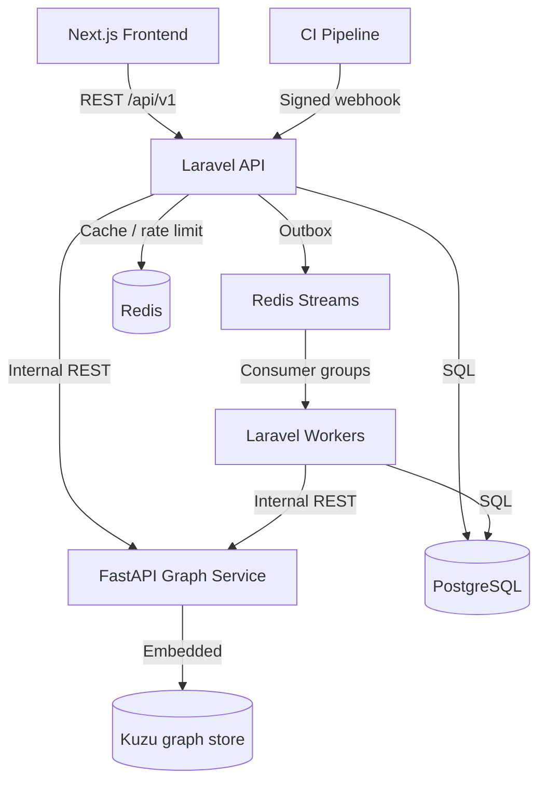

# BlastSpec

**API Contract Change Impact Analyzer**

Upload OpenAPI specs, build a service-dependency graph, and see exactly what breaks when a contract changes — affected services, teams to notify, and the order to migrate.

> Built to answer four questions before a deploy: **Who consumes this endpoint? What breaks? Who do we tell? What order do we migrate in?**

---

## Why this is different

Most OpenAPI tools lint a single document. BlastSpec models the **cross-service blast radius**:

- Reverse reachability from a changed endpoint to every direct and transitive consumer
- Topological migration order with cycle detection (Tarjan SCC)
- Owner teams attached to every affected service
- Async analysis with a transactional outbox, Redis Streams, and a DLQ
- A graph UI with declared vs inferred edges, plus an accessible list fallback

---

## Architecture



**Kuzu is embedded** in the graph service, not a separate server. Postgres is the system of record; the graph is derived and rebuildable.

---

## Tech stack

| Layer | Stack |
|---|---|
| Frontend | Next.js (App Router), TypeScript, Tailwind CSS, shadcn/ui, TanStack Query, `@xyflow/react` + `elkjs` |
| API | Laravel, PHP 8.3+ |
| Graph service | FastAPI, Python 3.12, Kuzu, Pydantic v2 |
| Data | PostgreSQL 16, Redis 7, Kuzu |
| Messaging | Redis Streams with consumer groups |
| Contracts | OpenAPI 3.1 (`contracts/openapi.yaml`), generated TypeScript types |
| Tests | Pest, pytest, Vitest, Playwright |
| Infra | Docker Compose, Fly.io, Vercel |

Exact versions are pinned at scaffold time and recorded here.

---

## Quick start

```bash
git clone <repo-url> blastspec
cd blastspec
cp .env.example .env

docker compose -f infra/docker-compose.yml up --build
docker compose -f infra/docker-compose.yml exec backend php artisan migrate --seed
```

Open:

- App: http://localhost:3000
- API: http://localhost:8000/api/v1
- Graph service (internal): http://localhost:8001

Demo credentials:

```text
Email:    demo@blastspec.dev
Password: demo-password
```

The seed creates three services (`billing`, `checkout`, `notifications`), two versions of the billing spec, a completed diff, and an impact report.

---

## Demo script (5 minutes)

1. Sign in and open **Specs → billing**.
2. Upload `v2-breaking.yaml` (removes `email` from `User`, adds a required request field).
3. Open **Graph** — see `checkout` and `notifications` as consumers, `analytics` as a transitive dependent.
4. Open **Versions**, compare `1.0.0 → 2.0.0`.
5. Review critical changes in **Diff**.
6. **Generate impact report**.
7. Review affected services, owner teams, and migration waves.
8. Approve and **Print**.

Then show the CI path: `infra/webhook-example.sh` posts a signed payload, and replaying it returns the same report.

---

## Features (MVP)

- [x] Upload OpenAPI 3.0.x/3.1.x (JSON/YAML, 5 MB max)
- [x] Parse, canonicalize, and version specs
- [x] Build a service/endpoint/schema/consumer graph
- [x] Consumer discovery: `x-consumers`, host inference, manual bindings
- [x] Interactive graph explorer + accessible list view
- [x] Diff any two versions
- [x] 40+ breaking-change rules with severity
- [x] Reverse reachability and owner lookup
- [x] Topological migration order, waves, cycle reporting
- [x] Persisted impact reports with approval and print view
- [x] Signed, idempotent CI webhook
- [x] Transactional outbox, Redis Streams, retries, DLQ replay
- [x] Hashed CI tokens with scopes

---

## Advanced concepts demonstrated

| Concept | Where |
|---|---|
| Graph modeling | `DATA_MODEL.md`, `graph-service` |
| Reverse reachability | `GRAPH_ALGORITHMS.md` §2 |
| Kahn's algorithm | `GRAPH_ALGORITHMS.md` §4 |
| Tarjan SCC for cycles | `GRAPH_ALGORITHMS.md` §5 |
| Transactional outbox | ADR-0003, `ARCHITECTURE.md` §3 |
| Redis Streams consumer groups | ADR-0004 |
| Dead letter queue + replay | `ARCHITECTURE.md` §8 |
| Contract-first API | ADR-0001, `contracts/openapi.yaml` |
| Safe OpenAPI parsing | `SECURITY.md` §4 |

---

## Documentation

| Doc | Read it for |
|---|---|
| [`AGENTS.md`](AGENTS.md) | Agent entry point, commands, workflow |
| [`PRD.md`](PRD.md) | Requirements, scope, acceptance criteria |
| [`ARCHITECTURE.md`](ARCHITECTURE.md) | Services, data ownership, flows, failure modes |
| [`DATA_MODEL.md`](DATA_MODEL.md) | Postgres and Kuzu schemas, invariants |
| [`API_CONTRACT.md`](API_CONTRACT.md) | API conventions, errors, webhook signing |
| [`BREAKING_CHANGES.md`](BREAKING_CHANGES.md) | Rule catalog and severity |
| [`GRAPH_ALGORITHMS.md`](GRAPH_ALGORITHMS.md) | Reachability, ordering, cycles |
| [`DESIGN.md`](DESIGN.md) | Visual system and graph canvas |
| [`docs/SCREENS.md`](docs/SCREENS.md) | Screen-by-screen behavior and copy |
| [`RULES.md`](RULES.md) | Coding standards |
| [`TESTING.md`](TESTING.md) | Fixtures, commands, coverage |
| [`SECURITY.md`](SECURITY.md) | Threat model and controls |
| [`DEPLOYMENT.md`](DEPLOYMENT.md) | Compose, Fly.io, Vercel, runbooks |
| [`ENVIRONMENT.md`](ENVIRONMENT.md) | Env var catalog |
| [`ROADMAP.md`](ROADMAP.md) | Phases and exit criteria |
| [`TASKS.md`](TASKS.md) | Agent-sized backlog |
| [`docs/adr/`](docs/adr/README.md) | Architecture decisions |

---

## Testing

```bash
cd backend && php artisan test
cd graph-service && uv run pytest
cd frontend && npm run test
cd frontend && npx playwright test
```

CI gates: coverage thresholds, contract drift, docs links, security audits. See `TESTING.md`.

---

## Deployment

- Frontend: Vercel
- Laravel API + workers: Fly.io
- Graph service: Fly.io with a persistent Kuzu volume
- Postgres + Redis: managed free tiers or Fly.io

See `DEPLOYMENT.md` for the corrected compose topology and runbooks.

---

## Tradeoffs

- **Single demo workspace.** `workspace_id` is present everywhere so organizations can be added without a redesign.
- **Full graph snapshots.** Simple and deterministic at demo scale; incremental sync is future work.
- **Inferred consumers are approximate.** Provenance and confidence are surfaced; manual bindings fill the gaps.
- **Embedded Kuzu.** No separate graph server, but the graph service is stateful and single-writer.
- **Redis Streams over a simple queue.** More code, stronger reliability signal.
- **OpenAPI only.** AsyncAPI, GraphQL, and gRPC are out of scope.

---

## License

MIT
